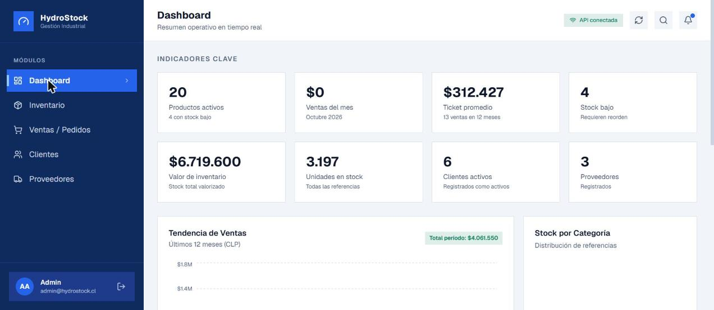
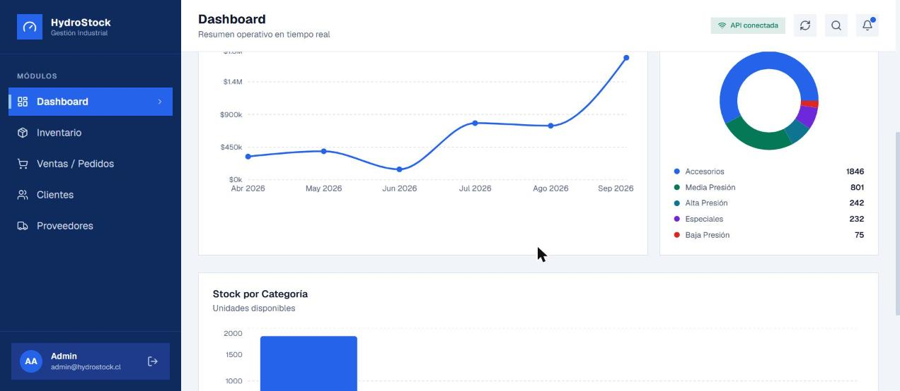
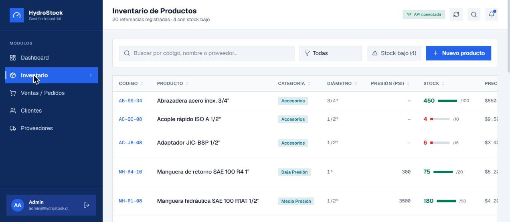
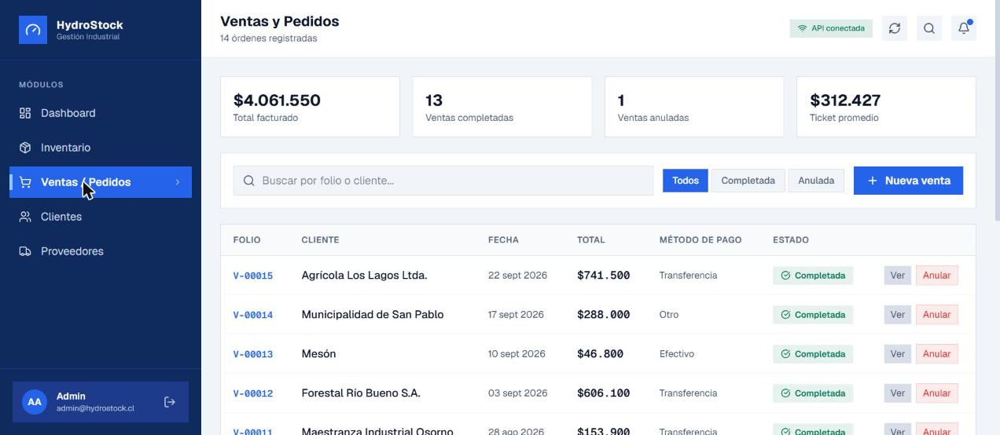
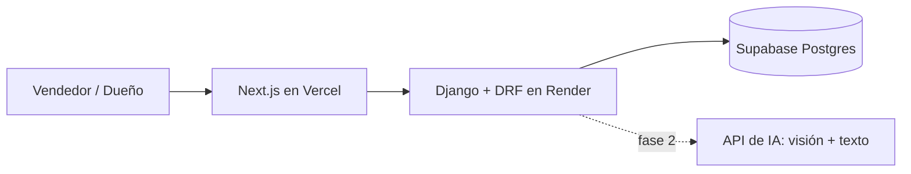

# HydroStock

**Sistema de gestión para una pyme que vende e instala mangueras hidráulicas: inventario, ventas y bodega en un solo lugar, con una capa de IA para identificar productos.**

> Proyecto de Título en equipo (3 personas). Código privado. Puedo mostrarlo en pantalla durante la entrevista.

## Capturas

Datos de demostración.

---

## El problema

El negocio cliente es una pyme de Osorno con 4 personas. Vende mangueras, cilindros, acoples y sellos, e instala en taller y en terreno. Hoy lleva el inventario y las ventas en cuadernos y las cotizaciones en Excel. Para saber si tienen una manguera, revisan las facturas de compra. Eso significa errores de stock, tiempo perdido en el mostrador y ninguna trazabilidad.

## Qué hace

**Ya construido y desplegado:**

- Inventario con ubicación en bodega.
- Registro de ventas y clientes.
- Dashboard con gráficos de ventas y stock sobre datos reales de la API.
- Roles de usuario: dueño, vendedor/bodeguero, secretaria.

**En desarrollo como parte del Proyecto de Título:**

- Identificación de mangueras por **foto o descripción en texto**, con IA de visión (Claude Vision), para decirle al vendedor qué producto es y si hay stock.
- Módulo de instalación en terreno: cotizaciones, órdenes de trabajo y seguimiento.
- Canal de WhatsApp con traspaso a un vendedor humano cuando la IA no esté segura.

## Arquitectura

**Stack:** Django, Django REST Framework, Next.js, Supabase (Postgres), Render, Vercel.

## Decisiones técnicas que importan

1. **Consolidación de líneas de venta en el backend.** Si el mismo producto aparece dos veces en una venta, la capa de servicio suma las cantidades en vez de crear líneas duplicadas. Es una red de seguridad que no depende de que el frontend se porte bien.
2. **Del dato falso al dato real.** El dashboard partió con datos de prueba fijos; lo reemplacé por llamadas reales a la API y corregí desajustes de claves entre el backend y los gráficos de ventas y stock.
3. **IA como apoyo, no como eje.** La IA ayuda a identificar el producto, pero el sistema funciona completo sin ella, y cuando no tiene confianza suficiente deriva a una persona. En un negocio real, un error de identificación cuesta una venta mal hecha.
4. **Migración de hosting** de Railway a Render, con el servicio ya desplegado.

## Estado y mi rol

- Fase 1 (inventario, ventas, bodega): la desarrollé yo y está desplegada.
- Fase 2 (IA, terreno, WhatsApp): trabajo en equipo con dos compañeros, líder del equipo en la primera unidad.
- El cliente aún no lo usa en el día a día; estamos en la etapa de validación y mejoras.

## Qué aprendí

Que levantar los requerimientos con las personas del negocio (quién vende, quién bodega, quién sale a terreno) cambió el diseño más que cualquier decisión técnica. También aprendí a poner la IA donde suma y no donde luce.
